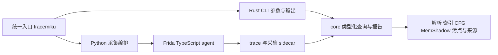

# traceMiku 采集与 CLI 设计

traceMiku 的维护范围是 Android ARM64 trace 采集与离线分析 CLI。主要消费者是通过
shell 调用工具的 AI 和脚本；交付物是可复查的 trace 与结构化运行时证据。
完整功能目录见 [FEATURES.md](FEATURES.md)，未完成工作只记录在 [TODO.md](../TODO.md)。

## 产品边界

traceMiku 回答静态工具无法独立确认的问题：某处是否执行、实际跳向哪里、当时的寄存器
是什么、运行时内存由谁写入、输出依赖哪些输入，以及结论在哪些采集缺口处停止。

静态反编译和完整代码结构由 IDA、Ghidra、Binary Ninja 等专业工具承担。协作接口是
`(SO, 静态偏移)`、绝对 PC、符号输入和运行时字节导出。CLI 不管理、不启动也不调用
反编译器；调用方可以独立使用任意静态工具，再按这些坐标对齐证据。本仓库不维护
Web UI、HTTP/OpenAPI、反编译桥接、本地高级 IL 管线或项目专用 MCP server。

分析已有 trace 不需要设备、Frida 会话、浏览器、反编译器或 LLM。采集侧仍需要真实
Android 环境；离线回归不能证明实际设备上的稳定性或吞吐。

## 当前架构

Rust 工作区仅包含 `tracemiku-core` 和 `tracemiku-cli`。CLI 依赖 core，不依赖
server、Axum、Tower 或 Tokio，也不构造 HTTP 请求。

| 职责 | 实现位置 |
|---|---|
| attach/spawn、入口解析、设备诊断与采集编排 | `tracemiku`、`tracemiku_device.py`、`tracemiku_commands.py` |
| 有界 ring、落盘 spool、JNI/外部写/快照等可选采集 | `tracer/src/core/`、`tracer/src/hooks/`、`tracer/src/sidecar/` |
| 分块回传、目标 profile 与可信插件 | `tracemiku_transport.py`、`tracemiku_target.py`、`tracer/src/target_plugins.ts` |
| 记录格式、mmap、索引、符号、CFG、污点、MemShadow、replay | `rust/crates/tracemiku-core/src/` 对应领域模块 |
| 查询上下文、参数校验、过滤、预算与响应模型 | `rust/crates/tracemiku-core/src/analysis/` |
| 输出回溯、字节 lineage、VM 推断与采集目录报告 | `rust/crates/tracemiku-core/src/analysis/reports/` |
| 参数解析、core 调用、JSON 序列化及文件输出 | `rust/crates/tracemiku-cli/src/` |
| 目标知识、固定偏移、应用专用 hook | `tools/hooks/` 或 `examples/<target>/` |

`AnalysisContext::load` 加载 trace、索引、元数据、模块与符号。CFG、函数索引、MemShadow、
调用关系等通过 `OnceLock` 按需构建；组合报告在一次进程内复用上下文。内存查询需要
MemShadow 时同步取得结果，不暴露后台加载或轮询状态。采集数据的内容指纹控制索引
缓存失效，缺失、陈旧或损坏的缓存可重建。

`analysis::Query` 表达类型化查询，`execute` 分派到各领域函数。领域函数不读取 CLI
参数，不包含路由、HTTP 状态或后台调度。高层报告也由 core 计算，CLI 不再维护另一套
VM/lineage 算法。测试中保留的字符串 fixture 适配器仅在测试编译时存在。

## 采集与数据契约

- `trace.bin` 每条记录固定为 272 字节；调用目录保持
  `calls/call_<序号>_tid<线程>_<记录数>r_<耗时>ms/`。格式变化必须单独版本化，
  详见 [Trace 数据契约](PER_CALL_TRACE_DESIGN.md)。
- 寄存器快照属于指令执行前状态。尾指令、被排除的调用、丢记录、线程边界和缺失
  sidecar 都可能使直接后态不可知，不能用邻接记录无条件补造状态。
- 保留 ring、记录数、调用数、worker、sidecar 与回传限制。调整吞吐时必须同时验证
  内存与磁盘预算；缓冲增长不能代替明确的失败语义。
- 文件完整回传后原子提交，失败保留 pending 与设备源 spool。已有恢复路径保留
  可用记录，不把不完整调用伪装成完整 trace。
- 目标 profile、JNI hook、反检测和插件继续是可选采集功能；目标知识不能进入 core。

## 分析证据与资源

- `(SO, offset)`、绝对 PC、call 与记录下标必须能相互定位。歧义、未执行、未命中
  与越界是不同结果；多次执行要明确 occurrence 或聚合方式。
- 内存来源遵守 [完整性契约](memory-completeness-design.md)：`w/r/x/i` 分别表示
  trace store、trace load、外部写和初始快照，`??` 表示未知。二进制导出必须同时给出
  完整度，不能把填充零当作观测事实。
- 污点、切片、lineage 附可回查的记录与来源，遇到证据缺口时停止或标记不确定。
  VM 与密码特征属于专项推断；VM profile 由调用方显式提供，不使用目标专用默认值。
- Trace replay 检查已有观测间的一致性，不承诺模拟未观测路径或重建完整算法。
- 查询保留各自的窗口、条数、深度或组合预算，超限时截断并报告元数据，或返回结构化
  限制错误。目前没有所有命令共用的总内存/输出预算；全量索引和部分汇总仍随 trace
  规模增长。大 trace 性能及这些边界的进一步收紧记录在 TODO，不宣称已经解决。

## CLI 契约

统一入口使用 argparse 定义采集参数，使用 Rust clap 定义分析参数。分析不在 Python
层重复实现。公开能力清单 schema 为 2：默认返回唯一命令摘要，选择单个命令时返回
完整参数。功能目录是唯一命令用法汇总，已删除命令的替代选择也只在那里维护。

成功分析返回 JSON，退出码为 0。`list` 默认逐行 JSON，显式 JSON 模式返回数组；
补全命令输出 shell 源码。Rust 执行层失败退出码为 1，stdout 返回
`{"status":"error","error":{"code":...,"message":...,"details":...}}`；`details` 可省略。
core 查询保留具体错误码与资源上限，其余编排错误使用 `command_failed`。参数解析失败
退出码为 2，stderr 返回参数诊断。部分旧查询仍在成功返回的结果中用 `status=error`
表达参数问题，调用方需同时检查结果状态；完整统一列在 TODO。采集失败仍沿用 host
的诊断与退出语义。

函数标识来自符号或运行时 trace，不接受 `bn:` 或旧 `cfg:` 命名空间。函数输出不包含
反编译可用性字段；writer 证据的 `source.command` 指向可调用的专用命令。分析成功结果
保留既有字段与证据含义，字段改动必须同步更新相邻层契约测试。

基础查询响应类型位于 core 的对应 `analysis` 模块，部分组合报告类型位于
`analysis/reports/output_*.rs`，schema 位于 `docs/schema/`。仍有动态 JSON 报告，不能把
已生成的 schema 误认为全部输出类型的覆盖证明。

## 验证边界

- core 单元测试覆盖算法、采集格式、缓存失效、内存来源与错误边界。
- `core/tests/analysis/` 的夹具验证各查询的语义、默认值、上限和失败结果。
- `cli/tests/contract_*` 通过真实二进制验证输出；`contract_offline` 通过统一入口与
  core 直接调用比较查询结果，`contract_entrypoint` 验证能力发现及旧命令拒绝。
- host 测试模拟设备、Frida 与传输故障；TypeScript 契约验证记录、外部写与插件 spool。
- 默认离线门禁不启动 HTTP 服务，不需要前端依赖或 BN。真机采集验证独立执行，
  无设备时必须在交付中保留该限制。

性能改善需要同机、同 trace、相同缓存条件下的测量。删除依赖和缩小命令目录本身
不能证明分析提速或 AI 查询质量提升。
