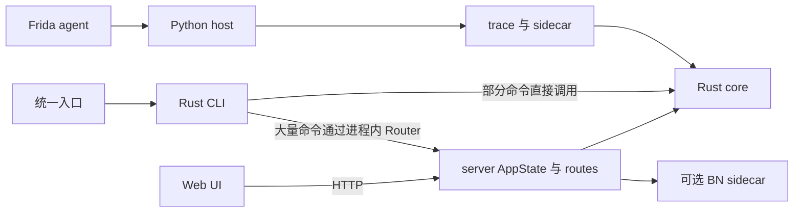
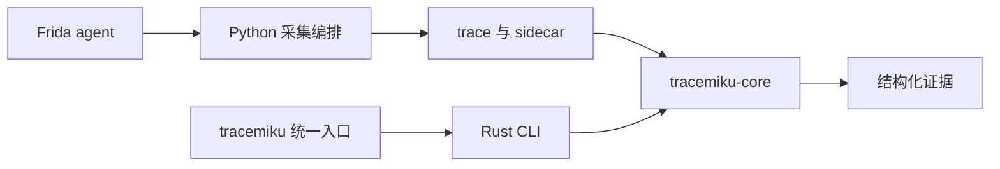

# traceMiku 采集与 CLI 设计

traceMiku 的维护范围收敛为 Android ARM64 trace 采集和离线分析 CLI，为 AI 补充静态
工具无法提供的运行时证据。裁剪采用现有实现迁移：保留数据格式、分析算法、故障恢复
和测试，将分析从 Web 运行环境中解耦。当前代码仍包含 server 和前端；下文的目标
边界尚未全部实现，待办只记录在 [TODO.md](../TODO.md)。

完整的现有功能目录仍以 [FEATURES.md](FEATURES.md) 为准，参数以统一入口的命令帮助
为准。本文定义需求、现状与目标边界，不维护第二份命令用法或开发路线图。

## 产品目标

主要消费者是通过 shell 调用工具的 AI 和脚本。它们应能回答：某个 SO 的某处是否
执行、执行了几次、当时寄存器是什么、间接跳转去了哪里、某段内存来自哪次写入、
某个输出依赖哪些输入，以及哪些结论因采集缺口而无法成立。

静态工具继续负责反编译与静态结构。traceMiku 用 `(SO, 静态偏移)` 与 IDA、Ghidra、
Binary Ninja 等协作。它的交付物是可复查的 trace 和有界 JSON 证据；源码重建、目标
算法复刻和分析结论的长篇解读由调用方完成。

成功标准包括：

- 没有设备、Frida 会话、浏览器或 BN 时，已有 trace 的本地分析仍能独立运行。
- 一条专用命令足以提出一个明确的问题，能力发现信息与统一入口实际接受的参数一致。
- 结果能定位回 call、记录下标和 PC；推断、未观测、截断与确定事实可区分。
- 采集失败仍保留可恢复的数据；分析资源与输出都有上限。

## 当前实现

### 实际依赖

下文用 core、CLI、server 简称 `rust/crates/` 下对应的 `tracemiku-*` crate。

CLI 的 `Cargo.toml` 直接依赖 `tracemiku-server`、Axum、Tower 和 Tokio。
其 `src/lib.rs::build_cli_router` 构造 server，`src/trace_api.rs` 用 `Router::oneshot`
提交请求并收集 JSON。普通 CLI 查询不会因此监听 TCP 端口，也不要求先启动 Web；
问题是构建与执行仍耦合 server 的类型、缓存和生命周期。

`server/src/state.rs::AppState::load` 加载 trace 与索引、符号、CFG，并装配 MemShadow、
BN 管理器和各类缓存。`records` 这样的点查也经过这条初始化路径。是否构成特定大
trace 的性能瓶颈需要基准测量，不能仅凭依赖关系给出性能结论。

### 功能及其真实归属

下表中的 core/server 路径使用上述 crate 简称，单独的 Rust 文件名位于所述 crate
的 `src/`，其余路径相对仓库根目录。标记“保留”表示保留能力与正确性测试，不要求
保留当前模块位置、重复入口或展示字段。

| 能力 | 主要实现位置 | 裁剪后的归属 |
|---|---|---|
| attach、spawn、目标入口解析、Stalker 采集 | `tracemiku`、`tracemiku_device.py`、`tracer/src/core/` | 保留在采集链路 |
| 有界 ring、文件 spool、分块回传、pending 恢复 | `tracer/src/core/ring.ts`、`tracer/src/transport/spool.ts`、`tracemiku_transport.py`、`core/src/trace/finalize.rs` | 保留，属于采集可靠性的基础 |
| 目标 profile、可信插件、通用反检测选项 | `tracemiku_target.py`、`tracer/src/target_plugins.ts`、`tracer/src/anti_detect/` | 保留配置边界；目标知识留在 hooks/examples |
| JNI、外部写、内存快照、SIMD、fork 和 worker 证据 | `tracer/src/hooks/`、`tracer/src/sidecar/`、`tracemiku_fork.py` | 保留现有可选采集，依据 sidecar 可用性降级 |
| 272 字节解析、mmap、索引、地址与符号 | `core/src/trace/`、`index.rs`、`symbols.rs` | 保留在 core |
| CFG、调用关系、覆盖、间接跳转、寄存器查询 | core 的 `cfg.rs`、`calltree.rs`、`function_index.rs` 与 server routes | 保留结构化分析，将路由中的查询语义迁入 core |
| MemShadow、污点、依赖与切片 | core 的 `memshadow.rs`、`taint.rs`、`bfs_slice.rs`、`forward_dep_tree.rs` 与 server routes | 保留算法与来源模型，CLI 直接调用 |
| 字符串、JNI、密码特征、阶段识别、trace 对比 | core 部分模块，以及 server 的 `jni_scan.rs`、`phase_scan.rs` 和 routes | 保留有证据支撑的分析；启发式结论不能冒充观测事实 |
| 输出回溯、字节 lineage、VM 切片和聚合 | CLI 的 `output_semantics.rs`、`vm_*.rs` | 保留作为专项分析；计算语义迁入 core，格式化留在 CLI |
| Trace 锚定的指令重放验证 | `core/src/replay.rs`、`trace/evidence.rs`、CLI `replay_command.rs` | 保留，用于暴露发散和证据缺口 |
| HTTP、OpenAPI、后台状态、Web UI 与图形渲染 | server、`frontend/`、Web smoke/audit 脚本 | 已退出公开命令；内部实现待裁剪 |
| BN 进程管理、HLIL 和 BN CFG 桥接 | server 的 `bn_sidecar.rs`、`python_sidecar/`、`routes/bn_hlil.rs` | 已退出公开命令；内部实现待裁剪，静态反编译由外部工具承担 |

server 并非可以整体删除的展示层。例如 `routes/reg_at.rs` 包含执行值分布查询，
`jni_scan.rs` 和 `phase_scan.rs` 含分析计算；它们的语义与测试需要先迁移。CLI 中也
有 VM 操作识别和字节公式推断，不能把“已在 CLI”当作“已符合 core 唯一语义源”。

### 公开命令与剩余耦合

- 统一入口的采集参数与能力发现由 `tracemiku_commands.py` 定义，分析命令直接
  透传 Rust。`list/info/finalize/crypto/watch` 不再有第二套 Python 参数或执行逻辑。
- 公开的 `capabilities` 使用 schema 2，合并真实的采集与分析参数定义。默认只返回
  命令摘要，按命令请求时才返回参数，避免让 AI 为选一个工具读取全部参数。
- 旧别名、`api/query`、Web 启动、后台状态、SVG 和 BN 展示命令不属于公开入口，
  替代选择只在 FEATURES 维护。命令数量本身不证明过度设计，保留命令需要有明确的
  查询对象或证据语义，例如按 PC 聚合的寄存器分布与单次执行的寄存器值应当区分。
- `output_types*.rs` 覆盖部分高层报告；很多基础命令直接打印 route JSON。删掉 server
  时必须保留字段的类型和含义，不能以“统一输出”为名静默破坏已有消费者。
- core 的公开模块已无本地 LLIL/MLIL/HLIL 管线；当前反编译走 BN sidecar。后续实现
  应以现存源码和测试为依据，避免从历史文档重建已删除功能。
- 默认验证组合含前端审计、server 测试和 CLI/API parity。裁剪后应保留语义测试，
  将验证入口收敛到采集与离线 CLI，而非机械删除整个 server 测试目录。

这些事实支持缩小产品边界；尚不能证明 Web 端口本身导致了具体 AI 失败。评估效果
应使用真实提问到 CLI 查询的固定任务，而不是仅比较删掉了多少文件。

## 保留能力的契约

### 采集与恢复

- 继续使用 [Trace 数据契约](PER_CALL_TRACE_DESIGN.md) 的 272 字节记录与 per-call
  目录，保留已有 sidecar 的索引和来源含义。裁剪不同时引入格式重写。
- 寄存器快照属于指令执行前状态。尾部指令、被排除的调用、丢记录、线程边界和缺失
  sidecar 都可能破坏后态推断；无法确认时输出缺口，不能补造值。
- 保留默认有界 ring、记录数、调用数、worker、sidecar 和回传上限。调节吞吐时同时
  校验峰值内存与磁盘预算，不用无限缓冲掩盖消费者跟不上的问题。
- 保留 Frida/adb 两种现存传输的明确选择。超时、断线、满盘、校验不符必须留下可
  诊断状态；文件只在完整回传后原子提交，缺数据的 call 继续保持 pending。
- attach/spawn、JNI、反检测、fork 和 pthread 路径与真机行为有关。没有设备时保留
  这些实现，先收紧契约与离线故障测试；真实稳定性和性能必须由后续真机验收确认。

### 分析证据

- 保留 `(SO, offset)`、绝对 PC 和记录下标的关联；多模块匹配、未执行和超范围查询
  是不同结果，不能一律返回空数组。多次执行应允许确定 occurrence 或显式聚合。
- 保留 [内存来源契约](memory-completeness-design.md) 的 `w/r/x/i/??`。未知字节、
  外部写、初始快照和从寄存器推得的值不能混为一类；二进制导出也要暴露完整性。
- 污点、slice 和 lineage 必须附可回查的记录与来源，传播边界可见。VM/密码特征等
  专项推断保留启发式标记；VM profile 由调用方显式提供，不设目标专用默认值。
- Trace replay 检验已有观测间的一致性，缺失的状态不能自动当作验证成功；它不承诺
  将任意 trace 变成完整 CPU 模拟或独立算法实现。
- 大 trace 优先按需加载索引和执行有界查询。仍需保留内容指纹失效、缓存损坏后重建
  和批量查询复用，避免为去掉 Web 而丢掉实际有用的性能设计。

### CLI 消费契约

- 统一入口继续为 `./tracemiku`。Python 负责设备编排，Rust 负责离线分析；调用方
  不需要知道内部二进制路径。离线运行不应因缺少设备依赖而失败。
- 保留命令迁移时先保持已有 JSON 字段、类型、地址编码和状态含义；确需破坏兼容的
  变更单独明确版本与迁移规则，不批量加入占位字段或伪兼容别名。
- `capabilities` 描述统一入口真正可调用的采集与分析命令。schema 2 的每条摘要包含
  `name/about/implementation`，指定命令时额外提供 `args/subcommands`；未知命令
  返回 `status=error`、`error.code=unknown_command` 和退出码 2。后续版本变更需
  先锁定契约测试，内部 Rust 清单不替代这一公开契约。
- 分析成功时 stdout 是一个 JSON 文档，日志进 stderr。错误码、机器可读错误和
  参数错误的退出行为需要统一；未命中、歧义、证据不足和程序失败必须可区分。
- 每种可增长的输出都有条目或字节上限，以及实际返回量、截断标记和继续查询方式。
  计算预算与输出预算分别约束，不能只截掉最终 JSON 却先构造全部中间结果。
- 离线命令执行到完成、明确截断或失败；不让 AI 启动后台服务并轮询 Web 专用状态。

## 目标实现边界

优先复用 core 的现有模块。若多个命令确实需要共享 trace、索引和按需缓存，可将
`AppState` 中这部分提取为小型分析上下文；不要把 Router、HTTP 状态、BN 管理器或
Web 缓存整体搬进 core，也不需要先设计新的插件框架、任务系统或项目 MCP server。

展示设施退出范围包括 Web UI、静态站点服务、HTTP/OpenAPI、SVG 渲染、Web 后台状态
查询和相应浏览器测试。CFG、调用树、观察点、覆盖和寄存器时间线的 JSON 分析能力
仍有独立价值，不能因曾在 Web 面板中显示就删除。

命令删除必须同时反映到 FEATURES、能力清单、补全、契约覆盖声明、示例和统一入口，
并验证旧名称返回非零退出码，不静默转发。已有的命令删除负向测试与统一入口黑盒
测试在 `cli/tests/contract_entrypoint.rs`。裁剪前提交保留完整实现，不长期维护新旧
两套分析器。

BN 桥接随 Web 退出主产品。必须保留的是跨工具地址坐标、模块映射、符号输入和
运行时字节导出；确需 HLIL 的消费者直接调用外部静态工具。LLM 也不成为本地采集或
分析的运行依赖。

## 裁剪验收

| 边界 | 可离线确认的条件 | 仍需要外部环境的条件 |
|---|---|---|
| 构建依赖 | CLI 依赖树无 server/Axum/Tower；不用前端 Node 依赖即可构建和分析 | agent 自身仍需要 TypeScript 构建环境 |
| 数据兼容 | 既有 fixture 可读取，272 布局、meta 恢复、sidecar 来源和损坏降级保持测试覆盖 | 不同设备及 Frida 版本实际采集 |
| 分析迁移 | 保留命令的公共 JSON schema、关键值和失败语义一致；有价值的 route 测试迁到 core/CLI | 真实大 trace 的耗时和峰值内存基线 |
| 统一入口 | 黑盒测试通过 `./tracemiku` 运行；能力清单与帮助一致，stdout 可完整解析 | 真实 AI 任务的命令选择和补采效率 |
| 资源边界 | 输出上限、取消/超时、空 trace、截断、未知内存、缓存失效与预算耗尽均有断言 | 满盘、断线、进程崩溃和高负载下的真机恢复 |
| 范围完成 | 默认测试与文档不再要求 Web/BN，所有被保留的分析仍可用 | 若保留外部 BN 适配，需单独验证其协议 |

契约审计脚本的覆盖映射不等于语义正确性；仅启动内部 Rust 二进制的契约 helper
不能替代统一 Python 入口测试。迁移期可以暂用旧实现做差分校验，但不能
只让两边互相一致：已知事实的 fixture 断言、边界用例和历史 trace 仍是独立基准。

新维护者或后续 AI 应按这些契约迁移现有能力，用测试证明可删除的边界。仅靠功能
描述重新实现，会丢掉指令语义、缺口处理和设备故障方面的经验；若某个模块确需重写，
应以该模块的独立证据和契约为限。

## 待明确的取舍

收敛到采集与 CLI 的方向已确定。VM 高层模板生成中哪些属于通用能力、哪些应留给
目标示例，以及其余分析命令的稳定错误结构与版本策略，仍需在迁移对应边界前明确。
这些局部选择不妨碍先完成 core 与 CLI 的依赖解耦。
